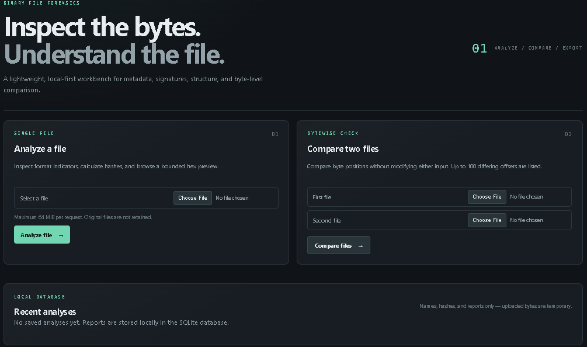
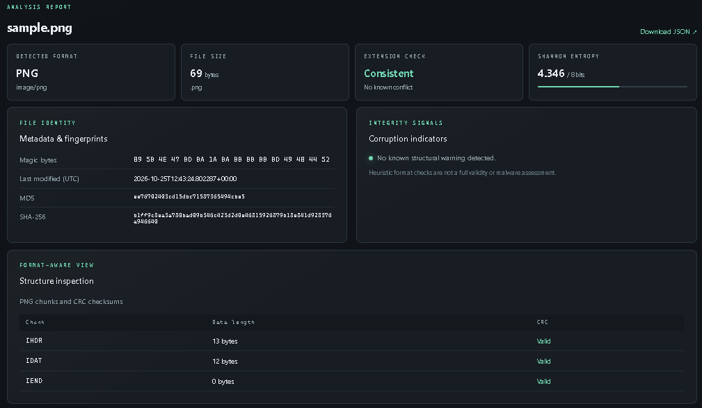
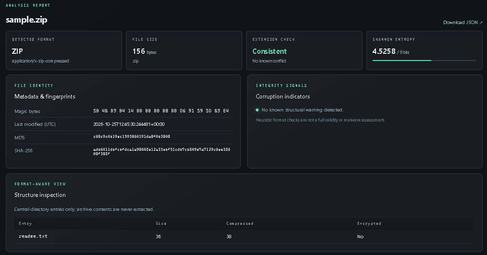
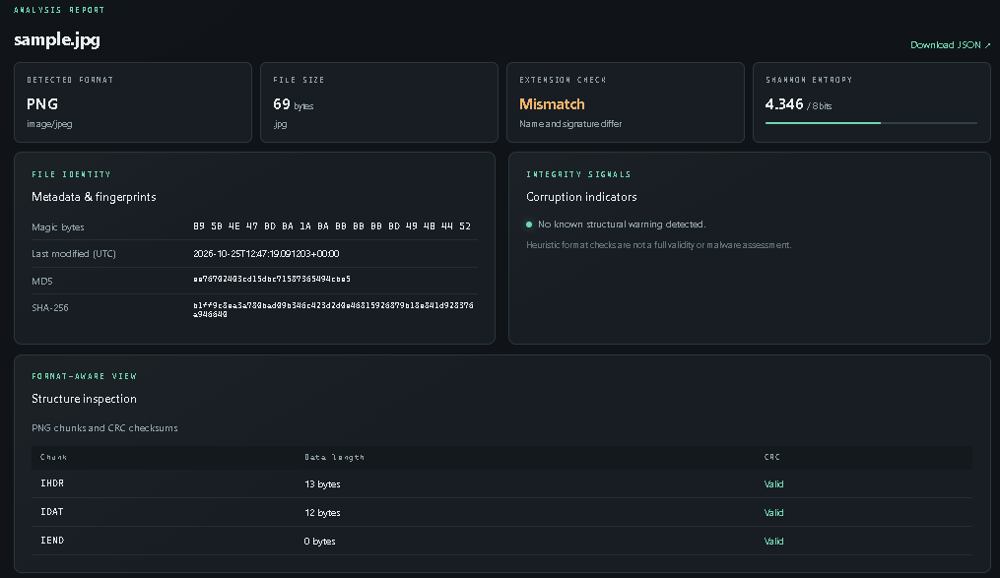
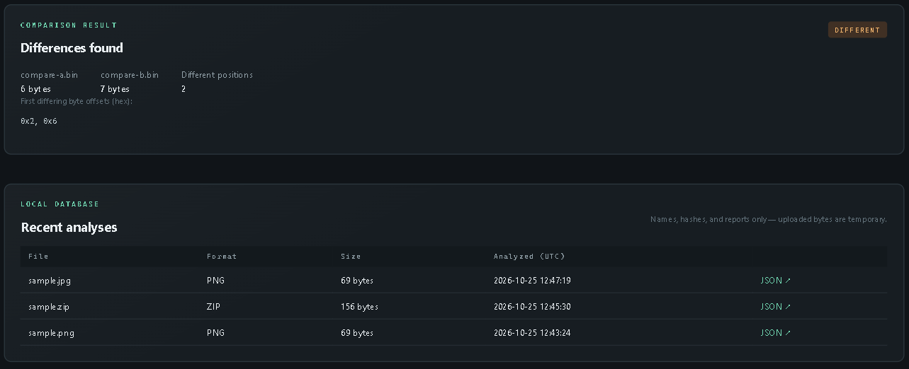
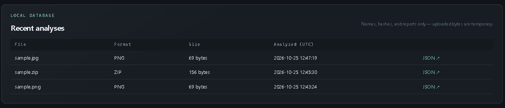

# ByteScope
### Binary File Forensics & Structure Explorer

ByteScope is a lightweight, local-first file analysis application built with Python and Flask. It examines file metadata, binary signatures, cryptographic hashes, entropy, embedded signatures, and format-specific structures through a clean web interface.

The project provides a practical introduction to binary file analysis and digital forensics, with tools for comparing files, identifying suspicious structural indicators, inspecting hexadecimal data, and maintaining a local analysis history.

## Features

### 1. File Analysis
- Upload a file for analysis through the web interface.
- Display the filename, extension, file size, and last-modified timestamp.
- Identify known file formats using magic-byte signatures.
- Compare detected file formats against filename extensions.
- Flag extension mismatches.
- Calculate MD5 and SHA-256 hashes.
- Estimate Shannon entropy to understand the distribution of byte values.
- Generate a bounded hexadecimal preview with byte offsets and ASCII representation.

### 2. Binary Signature Analysis
- Detect supported file signatures using their byte headers.
- Identify selected embedded signatures within file contents.
- Report signature offsets and estimated spans.
- Extract printable ASCII strings for further inspection.
- Highlight potential structural issues without executing the analyzed file.

### 3. Format-Aware Inspection

**PNG inspection**
- Identify PNG chunks, including `IHDR`, `IDAT`, and `IEND`.
- Display chunk lengths.
- Check chunk CRC values and report checksum mismatches.

**PDF inspection**
- Check PDF markers and selected structural indicators.
- Identify page-related markers where available.

**ZIP inspection**
- Read central-directory entries.
- Display entry names, sizes, compressed sizes, and encryption indicators.
- Inspect archive metadata without extracting archive contents.

Format checks are intentionally partial. A successful check does not establish that a file is completely valid or safe.

### 4. Corruption Indicators
- Surface selected structural warnings.
- Report PNG checksum mismatches and malformed format structures where detectable.
- Present findings as inspection indicators rather than definitive malware or corruption verdicts.

### 5. Binary File Comparison
- Compare two files byte by byte.
- Report the number of differing positions.
- Display the first differing byte offsets in hexadecimal.
- Identify differences caused by unequal file lengths.
- Limit the number of displayed differences to keep results manageable.

### 6. File Carving Indicators
- Identify selected embedded signatures.
- Report estimated offsets and spans that may indicate embedded or recoverable content.
- Provide inspection hints without claiming that complete files have been recovered.

ByteScope's carving functionality is an indicator-based analysis feature; it does not guarantee successful file recovery.

### 7. Local Analysis History
- Store recent analysis records in a local SQLite database.
- Display analyzed filenames, detected formats, file sizes, and timestamps.
- Retain report-related information without retaining the original uploaded file bytes.
- Provide access to saved JSON analysis reports.

### 8. JSON Report Export
- Export analysis results as JSON.
- Preserve relevant metadata, hashes, detection results, and inspection findings in a structured format.
- Use exported reports for documentation, debugging, and further analysis.

### 9. Web Dashboard
- Clean, dark developer-tool interface.
- Separate workflows for single-file analysis and binary comparison.
- Structured result panels for file identity, integrity indicators, format inspection, and hexadecimal output.
- Responsive layout for desktop and smaller screens.

## Workflow Architecture

The following diagram illustrates ByteScope's architecture, showing how the Flask web application connects the user interface, file analysis modules, binary comparison, local analysis history, and JSON report export.


### Workflow Overview

1. **User Interface:** Users upload files, compare binary files, view analysis results, access recent history, and download JSON reports through the web dashboard.
2. **Flask Web Application:** `app.py` handles application routes, upload validation, request-size limits, and communication between the interface and analysis components.
3. **File Analysis:** `file_analyzer.py` coordinates metadata collection, file-type detection, extension checks, hashing, entropy calculation, and hexadecimal preview generation.
4. **Analysis Modules:** `signatures.py`, `hashing.py`, `hex_viewer.py`, and `analysis_features.py` provide signature detection, cryptographic hashes, hexadecimal inspection, and format-specific analysis.
5. **Binary Comparison:** The comparison workflow examines two files byte by byte and reports differing positions and offsets.
6. **Analysis History:** `history.py` manages analysis records and retrieves saved information from the local SQLite database.
7. **JSON Report Export:** The application returns structured analysis reports for download.
8. **Results Presentation:** The dashboard displays analysis findings, structural indicators, comparison results, and recent analysis records.

ByteScope is designed for local file inspection. Uploaded files are treated as untrusted data, and format-specific findings are intended to support analysis rather than provide a definitive security verdict.

## Screenshots

### Dashboard

The main interface provides file analysis, binary comparison, and recent analysis history.



### File Analysis Report

The report displays the detected format, file size, extension check, entropy, metadata, cryptographic hashes, integrity indicators, and format-specific information.



### Format Inspection

ByteScope inspects ZIP archive metadata and directory entries without extracting archive contents.



### Extension Mismatch Detection

A PNG file saved with a `.jpg` extension demonstrates how ByteScope compares the detected file format with its filename extension.



### Binary Comparison

The comparison interface reports differing byte positions and their hexadecimal offsets.



### Analysis History

The local history panel displays recent analysis records and links to their JSON reports.



## Technology Stack

| Technology | Purpose |
|---|---|
| Python | Core analysis logic |
| Flask | Local web application and routes |
| HTML | Dashboard structure |
| CSS | Layout and visual styling |
| JavaScript | Browser-side interactions, where applicable |
| SQLite | Local analysis history |
| `hashlib` | MD5 and SHA-256 calculations |
| `struct` and `zlib` | Binary structure parsing and CRC checks |
| `pytest` | Automated testing |

The project prioritizes Python's standard library and lightweight dependencies to keep local development practical on modest hardware.


### Main Components

- `app.py` — Flask application, upload handling, analysis routes, comparison workflow, and report delivery.
- `file_analyzer.py` — Coordinates file metadata collection, detection, hashing, entropy, and hexadecimal preview generation.
- `signatures.py` — Known file signatures and file-type detection.
- `hashing.py` — Streaming hash calculations.
- `hex_viewer.py` — Bounded hexadecimal and ASCII preview generation.
- `analysis_features.py` — Advanced analysis helpers, including format inspection and binary findings.
- `history.py` — Local SQLite analysis history.
- `templates/index.html` — Dashboard and result presentation.
- `static/style.css` — Application styling.
- `tests/` — Automated tests for core analysis, advanced functionality, and application routes.

## Requirements

- Windows 10 or later, or another Python-compatible operating system.
- Python 3.12 recommended.
- A web browser.
- `pip` and a virtual environment.

## Installation

### 1. Clone the repository

Clone ByteScope from your GitHub repository, or open your existing local project folder.

### 2. Open the project directory

In PowerShell:

```powershell
cd C:\Users\Karth\Downloads\ByteScope
```

### 3. Create a virtual environment

If you do not already have one:

```powershell
py -3.12 -m venv venv
```

### 4. Activate the environment

```powershell
.\venv\Scripts\Activate.ps1
```

If PowerShell blocks activation, you can use the environment's Python executable directly without changing your execution policy.

### 5. Install dependencies

```powershell
python -m pip install -r requirements.txt
```

## Running ByteScope

With the virtual environment activated, run:

```powershell
python app.py
```

Alternatively, without activating the environment:

```powershell
.\venv\Scripts\python.exe app.py
```

Open the local application in your browser:

**http://127.0.0.1:5000/**

Keep the terminal running while using the application. Press `Ctrl + C` in that terminal when you want to stop the server.

## Usage

### Analyze a File

1. Open the ByteScope dashboard.
2. Select a file in the single-file analysis section.
3. Click **Analyze file**.
4. Review the detected format, file metadata, hashes, entropy, and extension check.
5. Examine any available format-specific details and structural warnings.
6. Browse the hexadecimal preview and other analysis findings.
7. Use the JSON export link to save the report if required.

### Compare Two Files

1. Locate the binary comparison section.
2. Select the first file.
3. Select the second file.
4. Click **Compare files**.
5. Review the differing byte positions and offsets.

For example, comparing the byte sequences `ABCDEF` and `ABXDEFG` produces differences at offsets `0x2` and `0x6`.

### Inspect Analysis History

1. Analyze one or more files.
2. Return to the dashboard's recent-analysis section.
3. Review the recorded filenames, detected formats, sizes, and timestamps.
4. Open an available JSON report through its history link.

### Create a Deliberate Extension Mismatch

1. Create or select a valid PNG image.
2. Copy it to a filename ending in `.jpg`.
3. Upload the renamed copy.
4. Check that ByteScope detects PNG content and reports the extension mismatch.

This demonstrates why file extensions alone should not be trusted to identify file formats.

## Security and Privacy

ByteScope is designed for local inspection of untrusted files.

- Uploaded files are treated as data, not executable programs.
- The application does not intentionally execute uploaded files or embedded content.
- Analysis is performed on temporary upload copies.
- Temporary upload files are removed after processing.
- Original files on the user's computer are not modified by the analysis workflow.
- File uploads are subject to a configured request-size limit of 64 MiB.
- Hashing uses incremental reads, while hexadecimal previews and displayed findings are bounded.
- ZIP inspection reads directory metadata without extracting archive contents.
- Analysis history is stored locally using SQLite.
- The application does not require a cloud analysis service.

**Security limitation:** ByteScope is a file-inspection utility, not a sandbox, antivirus engine, or complete malware-detection system. A file that produces no warnings must not be assumed safe.

Only analyze files you are authorized to inspect. Use additional isolation and appropriate security precautions when handling potentially malicious samples.

## Testing

ByteScope uses `pytest` for automated testing.

Run the complete test suite from the project directory:

```powershell
python -m pytest -q
```

Or use the virtual environment's interpreter directly:

```powershell
.\venv\Scripts\python.exe -m pytest -q
```

The project was previously verified with **19 passing tests**. The tests cover core analysis and selected advanced behaviors, including file signatures, hashing, application workflows, comparisons, report export, and format-specific inspection.

Run the command again after making changes to confirm the current result.

## Project Structure

```text
ByteScope/
├── app.py
├── file_analyzer.py
├── analysis_features.py
├── signatures.py
├── hashing.py
├── hex_viewer.py
├── history.py
├── requirements.txt
├── README.md
├── .gitignore
│
├── templates/
│   └── index.html
│
├── static/
│   └── style.css
│
├── tests/
│   ├── conftest.py
│   ├── test_advanced_analysis.py
│   ├── test_analyzer.py
│   ├── test_app.py
│   ├── test_hashing.py
│   └── test_signatures.py
│
├── screenshots/
│   ├── dashboard.png
│   ├── png_analysis.png
│   ├── format_inspection.png
│   ├── extension_mismatch.png
│   ├── binary_comparision.png
│   ├── analysis_history.png
│   └── Bytescope-workflow.png
│
├── sample-files/
│   └── readme.txt
│
├── sample.txt
│
└── instance/
    └── history.sqlite3
```

### Key Components

- **`app.py`** — Flask application, upload handling, analysis and comparison routes, history, and report downloads.
- **`file_analyzer.py`** — Coordinates file metadata collection, signature detection, hashing, entropy analysis, and hexadecimal previews.
- **`analysis_features.py`** — Implements additional analysis features, including format-specific inspection and binary findings.
- **`signatures.py`** — Detects supported file formats using magic-byte signatures.
- **`hashing.py`** — Calculates MD5 and SHA-256 hashes using incremental file reads.
- **`hex_viewer.py`** — Generates a bounded hexadecimal and ASCII preview.
- **`history.py`** — Manages local analysis history using SQLite.
- **`templates/index.html`** — Contains the web dashboard and analysis result templates.
- **`static/style.css`** — Defines the dashboard's visual appearance and layout.
- **`tests/`** — Contains automated tests for core analysis, advanced features, hashing, signatures, and Flask routes.
- **`screenshots/`** — Contains application screenshots and the workflow architecture diagram.
- **`sample-files/` and `sample.txt`** — Local sample files used for demonstration or testing.
- **`instance/history.sqlite3`** — Local database used to persist analysis history.
- **`requirements.txt`** — Lists the project's Python dependencies.
- **`.gitignore`** — Defines files and directories that should be excluded from Git.


## Limitations

- File-type detection supports a finite set of known signatures.
- A matching signature does not prove that a file is valid or safe.
- Entropy is a statistical indicator and cannot independently identify malware or encryption.
- Embedded-signature matches may be false positives.
- ASCII extraction only returns selected printable byte sequences.
- PNG, PDF, and ZIP inspection covers selected structures rather than every format specification.
- ZIP entries are inspected without extraction; compressed contents are not fully analyzed.
- Carving results are estimates and do not guarantee file recovery.
- Structural warnings are heuristic indicators, not definitive corruption diagnoses.
- Binary comparison reports byte-level differences rather than explaining their semantic meaning.
- Analysis history and reports are local application data, not a centralized forensic evidence-management system.

## Future Improvements

Potential extensions include:

- More format-specific parsers and validation checks.
- Additional binary visualization and navigation.
- Configurable signature databases.
- More detailed comparison reports.
- Improved analysis-history filtering.
- Additional malformed-file test cases.
- Optional export formats for structured reports.
- Broader automated coverage for boundary conditions and unsupported formats.

These are possible future enhancements and are not claims about currently implemented functionality.

## Project Goals

ByteScope was built to explore practical concepts in:

- Binary file analysis.
- File signatures and magic bytes.
- Cryptographic hashing.
- Shannon entropy.
- Hexadecimal inspection.
- Format-aware structural parsing.
- File comparison and offset analysis.
- Basic file carving indicators.
- Local persistence and report generation.
- Safe handling of untrusted file uploads.
- Python testing and modular application design.

---

**ByteScope — Inspect the bytes. Understand the file.**

---